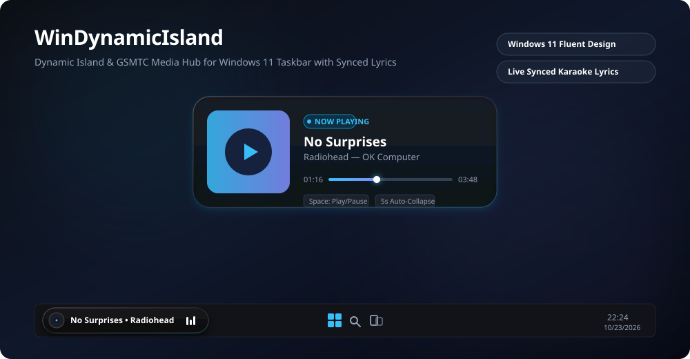

<div align="center">

# 🏝️ WinDynamicIsland

**An ultra-sleek, premium Apple Dynamic Island & Media Control Hub tailored specifically for Windows 11.**

[](https://python.org)
[](https://riverbankcomputing.com/software/pyqt/)
[](https://microsoft.com)
[](LICENSE)

<br />

<p align="center">
  
</p>

</div>

---

## 🌟 Overview

**WinDynamicIsland** brings the fluid, organic aesthetic of Apple's Dynamic Island straight into the **Windows 11 Taskbar**. Resting non-intrusively in your taskbar, it hooks directly into Windows native **Global System Media Transport Controls (GSMTC)** to provide real-time media states, synced karaoke lyrics, live audio spectrum bars, and instant interactive playback controls.

---

## ✨ Features

- 🎵 **Universal Media Sync (GSMTC Hook):**
  Works natively with **Spotify**, **Apple Music**, **YouTube / Chromium browsers**, **Edge**, **VLC**, and any Windows media player without needing third-party API tokens.
- 🎤 **Synchronized Karaoke Lyrics (LRC API):**
  Automatically queries synchronized lyrics and displays live scrolling phrases in the collapsed pill with an intelligent **~2.0s advance lead-in offset** so you can read lyrics ahead of the vocal delivery.
- 📊 **Animated Equalizer Spectrum:**
  A smooth 3-bar vertical audio spectrum that bounces in real-time when music plays and settles gracefully when paused.
- ⚡ **Windows 11 Taskbar Integration & Absolute Z-Order Lock:**
  Tied directly to `Shell_TrayWnd` using native Win32 API calls (`SetWindowPos`, `SetWindowLongPtrW`). Remains pinned on top of the taskbar even when taskbar buttons are actively clicked.
- 🌊 **Organic Spring Physics:**
  Smooth geometry transitions powered by Qt `QEasingCurve.OutBack` for both expanding and collapsing animations.
- ⏱️ **Auto-Collapse & Smart Hover Detection:**
  Expands with a single click. After **5 seconds** of inactivity, it automatically springs back into a compact capsule. Hovering pauses the timer so you can inspect tracks or read lyrics without interruptions.
- ⌨️ **Interactive Controls:**
  Press <kbd>Space</kbd> while expanded to instantly toggle Play / Pause.
- 👻 **Zero-Distraction Auto-Hide:**
  Runs completely silently in the background. Hides itself when no media is playing and automatically pops up the moment Spotify or any music starts.

---

## 🖥️ UI States

| State | Preview Description |
| :--- | :--- |
| **Collapsed (Taskbar Capsule)** | Compact pill sitting directly inside the bottom-left taskbar. Displays the circular album disc, synchronized live lyrics, and bouncing spectrum bars. |
| **Expanded (Interactive Card)** | Fluidly bounces upward into an Acrylic card revealing high-res album artwork, full song and artist details, interactive progress timeline slider, and duration timers. |

---

## 🚀 Installation & Getting Started

### Prerequisites

- **Windows 11** or Windows 10 (Build 19041+)
- **Python 3.10+** (Python 3.13 supported)

### 1. Clone the Repository
```bash
git clone https://github.com/YOUR_USERNAME/WinDynamicIsland.git
cd WinDynamicIsland
```

### 2. Install Dependencies
```bash
pip install -r requirements.txt
```

> **Note for Windows:** The project uses modern modular WinRT packages (`winrt-Windows.Media.Control`, `winrt-Windows.Storage.Streams`) and `PyQt6` for seamless compatibility on Windows 11.

---

## 🎮 Usage

### Run Directly
To launch the widget with console output:
```bash
python main.py
```

### Run in Background (No Console Window)
To launch silently in the background:
```bash
pythonw main.py
```

### 🔄 Auto-Start with Windows (Recommended)
You can configure **WinDynamicIsland** to start automatically with Windows in headless background mode:

```bash
# Enable auto-start with Windows:
python install_startup.py

# Disable auto-start anytime:
python uninstall_startup.py
```
*Once enabled, WinDynamicIsland sleeps quietly in the background upon PC boot. The instant you open Spotify and play a song, the island seamlessly appears on your taskbar!*

---

## ⚙️ Customization

You can easily tweak settings at the top of [`ui/window.py`](ui/window.py):

```python
# Negative delay in seconds (how many seconds ahead lyrics appear)
self.lyrics_offset = 2.0

# Collapsed & Expanded geometry
self.collapsed_width = 240
self.collapsed_height = 36
self.expanded_width = 340
self.expanded_height = 110

# Background acrylic tint
self.bg_color = QColor(15, 15, 15, 225)
```

---

## 📂 Project Architecture

```
WinDynamicIsland/
├── assets/
│   └── preview.svg              # Vector preview showcase banner
├── system_media/
│   ├── __init__.py
│   └── media_manager.py         # WinRT GSMTC session hooks & lyrics fetcher
├── ui/
│   ├── __init__.py
│   └── window.py                # Frameless PyQt6 island window & animations
├── install_startup.py           # One-click Windows startup installer
├── uninstall_startup.py         # One-click Windows startup uninstaller
├── main.py                      # Application bootstrap & qasync loop
├── requirements.txt             # Python dependencies
├── LICENSE                      # MIT License
└── README.md                    # Documentation
```

---

## 🤝 Contributing

Contributions are warmly welcome!
1. Fork the Project (`gh repo fork`)
2. Create your Feature Branch (`git checkout -b feature/AmazingFeature`)
3. Commit your Changes (`git commit -m 'Add some AmazingFeature'`)
4. Push to the Branch (`git push origin feature/AmazingFeature`)
5. Open a Pull Request

---

## 📄 License

Distributed under the **MIT License**. See [`LICENSE`](LICENSE) for more information.

<div align="center">
  <sub>Built with ❤️ for Windows 11 enthusiasts. If you find this project useful, feel free to give it a ⭐️!</sub>
</div>
